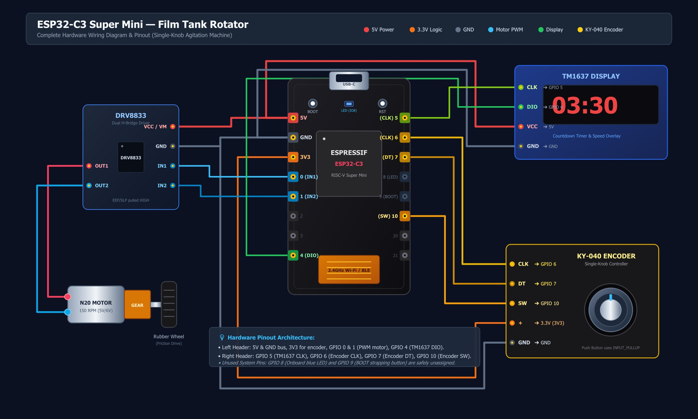
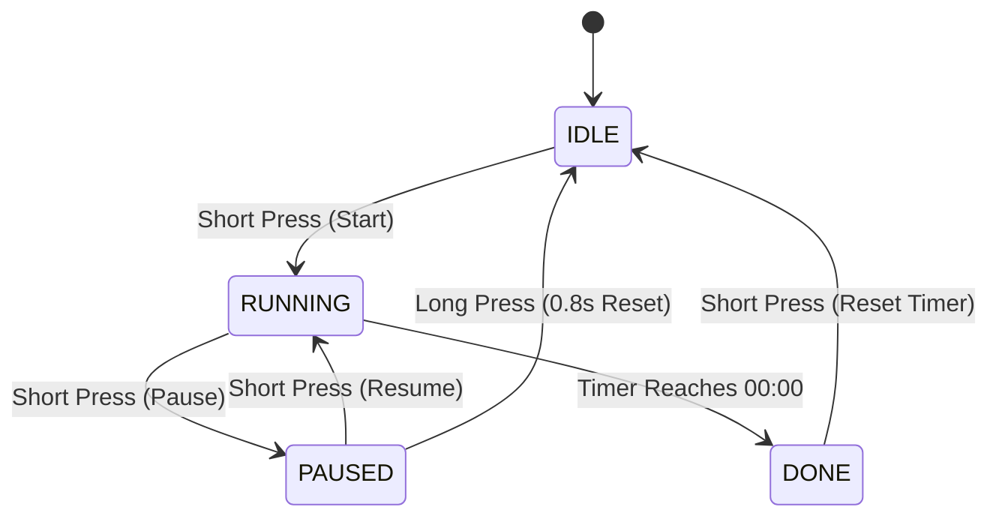

# ESP32-C3 Film Tank Rotator

[](https://www.espressif.com/)
[](https://www.arduino.cc/)
[]()
[]()
[](LICENSE)

[](https://www.youtube.com/@techcakelab)

An open-source, compact **Automated Film Development Tank Rotator** powered by the **ESP32-C3 Super Mini** microcontroller, an **N20 micro geared motor**, and an intuitive **single-knob Rotary Encoder UI**.

Designed to automate continuous and intermittent agitation for standard daylight film processing tanks (such as **Paterson**, **Jobo**, and **AP**), ensuring consistent, repeatable development times for **B&W**, **C-41**, and **E-6** chemistry without manual fatigue or uneven streaking.

---

## ✨ Features

- **Minimalist 1-Knob User Interface**: A single rotary encoder with an integrated push-button handles timer configuration, start/pause/cancel, and live motor speed adjustments.
- **Automated Reversing Agitation**: Periodic clockwise (CW) and counter-clockwise (CCW) rotation with resting intervals to dislodge air bubbles and ensure uniform chemical flow.
- **Real-Time LED Display**: 4-digit 7-segment TM1637 module displays `MM:SS` countdown, pulsing seconds colon, live motor speed overlay (`SP 70`), and flashing `donE` completion alert.
- **Ultra-Compact Footprint**: Built around the thumb-sized ESP32-C3 Super Mini (RISC-V) and DRV8833 dual H-bridge motor driver.
- **Friction-Drive Compatible**: Pairs with an N20 geared motor driving a rubber roller resting against the tank's exterior wall.
- **Dual ESP32 Core Compatibility**: Motor control automatically adapts to both **ESP32 Arduino Core 2.x** (`ledcSetup`) and **Core 3.x+** (`ledcAttach`).
- **No External Library Dependencies**: Self-contained project with bundled `TM1637Display` library.

---

## 🛠️ Hardware & Bill of Materials (BOM)

| Component | Specification | Description |
|---|---|---|
| **ESP32-C3 Super Mini** | RISC-V 160MHz, USB Type-C | Main controller board with high-efficiency PWM and compact pinout. |
| **N20 Geared Motor** | 5V / 6V, ~150 RPM | Fitted with a silicone / rubber wheel for friction-drive against the tank exterior. |
| **DRV8833 Motor Driver** | Dual MOSFET H-Bridge | Efficient motor driver with low heat dissipation and over-current protection. |
| **TM1637 Display** | 4-Digit 7-Segment (Red) | Displays countdown timer, speed percentage, and machine state. |
| **KY-040 Rotary Encoder** | Incremental Encoder + Switch | Single-point input device with built-in push-button. |
| **Power Supply** | 5V USB (Type-C) or 5V 1A–2A | Powers the ESP32, display, and motor driver directly. |

---

## ⚡ Wiring & Pinout Diagram



The pin assignments are specifically chosen to match the two physical headers of the **ESP32-C3 Super Mini**, keeping wiring clean and completely avoiding critical internal pins (such as the onboard LED on `GPIO 8` and the strapping/BOOT button on `GPIO 9`).

### Pin Assignment Table

| Module | Pin | ESP32-C3 Super Mini Pin | Notes |
|---|---|---|---|
| **Power Bus** | `5V` | **5V** | Supplies DRV8833 (`VCC` / `VM`) & TM1637 (`VCC`) |
| **Power Bus** | `GND` | **GND** | Common ground across all modules |
| **Power Bus** | `3V3` | **3V3** | Logic supply for KY-040 Encoder (`+`) |
| **DRV8833** | `IN1` | **GPIO 0** | PWM Channel 1 (Forward / CW) |
| **DRV8833** | `IN2` | **GPIO 1** | PWM Channel 2 (Reverse / CCW) |
| **DRV8833** | `OUT1`, `OUT2` | *To Motor* | Connect directly to N20 motor terminals |
| **DRV8833** | `EEP` / `SLP` | *Leave Float or 3.3V* | Most breakout boards pull this HIGH. If motor does not run, tie to 3.3V/5V. |
| **TM1637 Display** | `DIO` | **GPIO 4** | Display Data I/O |
| **TM1637 Display** | `CLK` | **GPIO 5** | Display Clock |
| **KY-040 Encoder** | `CLK` | **GPIO 6** | Encoder Phase A (Hardware Interrupt) |
| **KY-040 Encoder** | `DT` | **GPIO 7** | Encoder Phase B |
| **KY-040 Encoder** | `SW` | **GPIO 10** | Integrated push-button (`INPUT_PULLUP` enabled) |

> [!NOTE]
> Leave GPIO 8, 9, 20, and 21 unconnected to prevent interference with board strapping and boot modes.

---

## 🎮 User Interface & Operation Guide

The entire machine is operated using **only the single rotary knob**:



### 1. IDLE State (Standby)
*Display shows preset development time (e.g. `03:30`).*
- **Rotate Knob**: Adjust process time up/down in steps of **15 seconds** (Range: `00:15` to `60:00`).
- **Short Press**: Start development process (transitions to `RUNNING`).

### 2. RUNNING State (In Progress)
*Motor starts automatic agitation. Display counts down remaining time and pulses the center colon (`:`).*
- **Rotate Knob**: Adjust motor speed on the fly (Step: **5%**, Range: `30%` – `100%`).
  - The display temporarily shows the current speed setting (e.g. `SP 70` = 70%) for **1.5 seconds**, then returns to countdown.
  - At 70% duty cycle, a 150 RPM N20 motor delivers ~105 RPM, ideal for smooth, gentle chemical circulation.
- **Short Press**: Pause the cycle immediately (transitions to `PAUSED`).

### 3. PAUSED State
*Motor stops instantly. Display flashes the remaining countdown time.*
- **Short Press**: Resume development from the current time (transitions back to `RUNNING`).
- **Long Press (0.8s)**: Cancel process and reset timer to initial preset (transitions back to `IDLE`).

### 4. DONE State (Finished)
*Countdown completes. Motor halts. Display flashes `donE`.*
- **Short Press**: Acknowledge completion and restore initial preset time for the next bath (e.g. Stop Bath / Fixer) (transitions to `IDLE`).

---

## ⚙️ Agitation Cycle

The firmware executes a proven bidirectional rotation routine designed to replicate manual tank inversion:

1. **Clockwise (CW) Rotation**: 10 seconds.
2. **Rest / Settling Pause**: 1 second (lets chemicals settle and trapped air bubbles release).
3. **Counter-Clockwise (CCW) Rotation**: 10 seconds.
4. **Rest / Settling Pause**: 1 second.
*(Cycle repeats until total time reaches zero).*

All cycle parameters, timings, and PWM values can be customized in [`config.h`](file:///c:/Users/LENOVO/.gemini/antigravity-ide/scratch/esp32_film_tank_rotator/config.h):

```c
#define DEFAULT_DEVELOP_SEC 210    // Default 3:30 (C-41 developer standard)
#define TIMER_STEP_SEC      15     // 15 seconds per encoder step
#define AGIT_ON_SEC         10     // Agitation duration per direction (seconds)
#define AGIT_PAUSE_SEC      1      // Pause between reversals (seconds)
#define DEFAULT_SPEED_PCT   70     // Default motor duty cycle (70%)
```

---

## 💻 Flashing Firmware (Arduino IDE)

### 1. Requirements
- [Arduino IDE](https://www.arduino.cc/en/software) (2.x recommended)
- **ESP32 Board Package**: Open *Preferences* in Arduino IDE and add the ESP32 board manager URL:
  ```text
  https://espressif.github.io/arduino-esp32/package_esp32_index.json
  ```
  Then install `esp32` via **Boards Manager**.

### 2. Upload Steps
1. Clone or download this repository.
2. Open [`esp32_film_tank_rotator.ino`](file:///c:/Users/LENOVO/.gemini/antigravity-ide/scratch/esp32_film_tank_rotator/esp32_film_tank_rotator.ino) in Arduino IDE.
   *(Note: The TM1637 driver is bundled directly in the project folder, so no additional library installation is required).*
3. Under the **Tools** menu, configure:
   - **Board**: `ESP32C3 Dev Module` (or `AirM2M CORE ESP32C3`).
   - **USB CDC On Boot**: `Enabled` *(Crucial for Serial Monitor debugging over native USB-C)*.
   - **Flash Size**: `4MB`.
   - **Port**: Select the COM port corresponding to your ESP32-C3 board.
4. Click **Upload**.

> [!TIP]
> If your board does not enter bootloader mode automatically:
> 1. Press and hold the **BOOT** button (GPIO 9).
> 2. Plug in the USB cable (or press the **RESET** button briefly).
> 3. Release the **BOOT** button.
> 4. Click **Upload** in Arduino IDE.

---

## 📄 License

This project is licensed under the [MIT License](LICENSE). The included `TM1637Display` library is licensed under the GNU Lesser General Public License (LGPL v2.1) by Avishay Orpaz.
